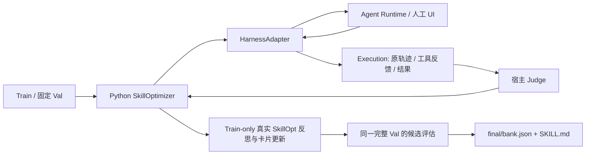

# 架构与算法来源审查

## 结论与选型依据

复用的算法底座是 **SkillOpt 的 `gradient/reflect.py`、`optimizer/skill.py` 和 `types.py`**。直接适合工程抽取的是 **OfficeQA 的已冻结经验卡流程**：源码和冻结记录可对应，轨迹转换、解析审计、卡片更新、部署路由、完整 Val 选择均有真实入口。华为和 WebShop 已实际复用这些入口；不必把 SkillOpt 的完整 Trainer 和所有模型后端一起迁移。

本次读取实际 `.py`、冻结记录的代码哈希和运行库版本；没有只按 README 选型。OfficeQA `frozen/freeze.json` 的 2026-11-03 决策为 `val-learned-v2-text`；核验 `oqs/learn.py/method.py/freeze.py/episode.py/container_entry.py/relay.py` 均匹配冻结哈希。WebShop `frozen/final.json` 的 2026-11-07 最终候选是 `fresh-routed-v5`，`fresh_learn/select/freeze` 也与冻结记录一致。GDP `configs/protocol-freeze.json` 明确指定 `optimizer_batched.py`。证据与源文件哈希保存在 `reports/SOURCE_AUDIT.json`；原记录不打包，避免混入数据和服务器配置。

“较新文件”不自动等于“统一成熟实现”。GDP 后续大量恢复包装器、华为各任务族和 SpreadsheetBench v2 的分支都不是一个现成的通用 Trainer。本交付不声称所有分支已被完整移植为同一个算法。

## 各项目真正的区别

| 项目与有效源码入口（相对原研究父目录） | 实际学习与选择 | 交接处理 |
|---|---|---|
| `SkillOpt/skillopt/gradient/reflect.py`、`optimizer/skill.py` | 通用分批成功/失败反思、结构化补丁；完整 `engine/trainer.py` 另外有合并、编辑裁剪、逐步 Gate、slow/meta 等 | 保留实际调用的反思/补丁/类型；导入所需 slow/meta 工具留在私有 vendor 内，但默认不执行 |
| `officeqa-skill-research/oqs/learn.py`、`method.py`、`freeze.py` | 成功/失败分别 M=5、每批 L=3、seed=20261103；保留旧卡、追加新卡；精确来源解析、正文归一化去重；词汇 top6；全 Val 按成功数、平均请求数、bank 字节数、run 名选择 | 默认主线；完整算法入口可独立导入 |
| `webshop-skill-research/wsr/learn.py`、`fresh_learn.py`、`select.py` | 早期同型分批卡；后期真实 No-Skill/Skill 配对，仅严格结果不一致的 Train 轨迹进入残差反思；短文本和稀疏候选独立生成；最终特定卡 top2；hard→soft→正文短选；另有独立 confirmation | 保留原提示词和排名规则；配对收集、压缩候选生成及服务未移植，不能把普通单臂学习称为该最终方法完整复现 |
| `gdpevo-skill-research/optimizer.py`→`optimizer_syntax.py`→`optimizer_batched.py`、`final_train.py` | 每业务组联合 4/5 个 Train，最多8条 append；长轨迹按2.5MB整实例分批，源序合并去重；开发选择学习协议，最终5例重拟合；不是成功/失败分开采样的 OQ 学习器 | 源码与协议审查、原提示词保留；联合学习、cross-fit、业务 parser 的专用语法恢复未迁入默认学习器 |
| `huawei-skill-data-research/experiments/hfs/learn.py`、`hf_next/learn.py`、`hf_round2/learn.py` | 复用 OQ flatten/parser + SkillOpt；任务族整体 Skill；结构化 Judge，不假设真实坏例答案是学习输入；完整文本，图片/音频以原记录哈希索引；按实例字段过滤；后期 M 自适应、L=2；整卡18k预算 | 提取二进制索引函数，保留提示词；实例字段扫描、18k装卡和领域评分在原工程，不能用默认top6替代后声称等价 |
| `huawei-skill-data-research/experiments/hf_next/fit_skill.py` | Train卡的覆盖/冗余/预算贪心部署子集，无推理、不重写规则；不是 Validation 逐卡收益 Gate | 不作为默认算法引入；迁移时如需该预算策略需独立适配/验证 |
| `spreadsheetbench-v2-skill-research/sbv2/learn.py`、`recover_learning.py` | 再次直接复用 OQ 与 SkillOpt；M≤4、L=3、整轨迹输入预算；单冻结候选先冻结后验证 | 作为更晚实际复用证据；不把 Windows COM/表格官方评测器打入核心包 |

原 SkillOpt 完整 Trainer 的 aggregate/clip/Gate/slow/meta 流程确实存在，在 SpreadsheetBench v1 等实验使用过。**它不是 OfficeQA/WebShop/华为经验卡主线的默认运行路径。** 默认不会新增逐卡拒收 Gate、向量检索、LLM 路由、子 Agent 或参数训练。私有 vendor 的 `evaluation/gate.py` 原样保留以便追溯原版功能，但 `select_candidate` 的最终排名不冒充该 Gate。

`trace2skill-*`、`SkillEvolver` 以及各种 `recover_*` 不因为同目录存在而被并入本工程。旧候选和恢复脚本可保留历史复现价值，但不是本次核心依赖。没有删除或改动它们。

## 三层边界与真实入口

- `pipeline.SkillOptimizer.run`：固定 Train/Val 清单；调用 Adapter/Judge；执行学习和候选 Val；排名与最终冻结。它是新增加的薄编排层，不是声称原研究已有统一 Trainer。
- `core.learn`：不认识 OpenClaw/Benchmark 目录，只接受 `Experience`、seed bank、反思模型和提示词；强制 Train-only 和 qualified。
- `_vendor/skillopt/gradient/reflect.py`：真正的成功/失败分组、分别随机打散、分批、多线程、原提示词构造和每批编辑预算截断。源文件只替换导入命名空间。
- `research/officeqa.py`：从最终 `oqs/learn.py` 精确提取的 native flatten、实例过滤、`AuditedReflectionParser`。操作词表改为每实例可传参数，原默认集合不变，避免领域切换污染其他学习器。
- `_vendor/skillopt/optimizer/skill.py`：原版补丁应用和报告。经验卡学习调用 `append`，不会用“整理工程”为由改成自由重写。
- `core.render_bank` / `research/officeqa_routing.py`：前者更换为跨领域 metadata/header，后者是原 OfficeQA 完整文件；后者含 OfficeQA 专用 contract，不能直接声称可在小艺 Work 执行该工具。
- `core.select_candidate`：OfficeQA 或 WebShop 的实际已有排名策略。所有候选必须覆盖同一固定完整 Val。
- `adapters/openclaw.py`：延用原 Python subprocess、`skills list --json`、`agent --local`、session JSONL 接口；重新参数化运行库和模型配置。
- `adapters/exchange.py` / `xiaoyi.py`：不假定目标 API 的文件交换边界；可人工完成、可接脚本。

`contracts.py` 直接复用上游 `RawPatch/Edit/Patch/RolloutResult`。没有另写一套反思补丁类型。原 `EnvAdapter` 同时绑定数据加载、环境构建、领域反思等职责，无法原封不动充当纯 Runtime 接口；因此新增很小的 Harness Protocol，保持上游学习器不变，而不是完整重开发 Agent 框架。

## 默认算法逐步说明

1. 每个任务只将 `Task.public()` 与当前路由后的 Skill 交给 Harness；私有答案/参考和 Judge 留在宿主。
2. 返回完整 native conversation、独立工具反馈和原始最终交付。真实环境缺失的步骤不能补编。宿主 Judge 给出 strict hard、soft、结构化原因和 qualified 状态。
3. 原 native 行先单独保留。使用原 flatten 按消息身份去除 compaction 复制，保留不同ID的重复调用、thinking、toolCall、toolResult。华为提取函数只将二进制块变成不可推断像素的哈希说明，原始块仍保留；不会裁剪文本轨迹。
4. 只把 Train 的反馈与 Train reference 送给反思器。成功/失败分别按原 seed 打散和 M 分批；调用原反思函数。新工程每个 learner 加载一个私有模块实例，注入模型和 parser，避免原脚本的全局猴补丁互相干扰。
5. parser 先用上游 JSON 提取，再作可审计语法修复；卡片字段、操作集合和每段文本必须可在原响应找到，禁止引入语义。无法确定的解析失败保留原响应并停止。零编辑是合法结果。
6. 所有 patch 用原规则排序。先 schema/实例过滤，再正文小写/空白归一化 SHA 去重，再用原 append 操作得到卡体；保留旧卡、来源、更新报告；audit 落盘后才提交 bank。
7. 路由仅使用公开问题的 Unicode 字母词。触发短语连续完整匹配；通用 `*` 卡不占非通用 top-k；同分按 bank 顺序，渲染仍按 bank 原顺序。不是向量或运行状态路由。数字不会成为词汇触发特征。
8. 用同一套 Harness/Judge 在相同完整 Val 上评价 seed 和学到的候选。默认 OQ 顺序：严格成功数多 → 平均实际 API 请求少 → bank 文件字节数小 → 名称。未知请求数不允许冒充0进入该策略。WebShop 策略另为 hard→soft→正文长度→名称。
9. 最终选中 bank 后冻结；Test 不进入学习或选择。保存静态全卡 `SKILL.md`，也保留针对下一道任务重新路由的 bank。

`rounds=1` 是默认最小实验。`rounds>1` 是迁移编排提供的显式重复 append 链：重新在 Train 执行上一版卡库，继续学习，最后统一对全部候选验证；不是原各 Benchmark 调度器的逐字复刻，也没有根据 Val 轨迹改写下一轮。更复杂的阶段/配对/confirmation 协议应保留原预登记方法，不由这个开关代替。

## 工程变化与行为边界

保持的算法内容由 `PROVENANCE.json` 和 `tools/check_source_equivalence.py` 验证：vendored 文件仅替换命名空间；提取函数逐段记录源位置；合成输入下原反思器产生完全相同的 system/user/options/patch，原卡片更新代码块产生相同卡片正文/ID。测试不等于证明不同模型或 Harness 的实际收益不变。

有意隔离的环境差异：

- 模型端点/凭据读取从算法导入中移除，改由可注入客户端承担；不会自动加载个人服务器密钥。
- 路径、日志和锁跨平台化。旧 `fcntl`、`/proc`、tmux、Docker 编排不进入核心依赖。
- 默认通用提示词/Skill metadata 是迁移配置示例，原四领域提示词另附。用户选用它们的效果需实测。
- bank 的路由/contract/progress 标志由配置保留，不擅自将 OpenClaw 专用 progress 开关施加给其他 Harness。没有迁移旧进度拦截器，也不虚称其存在。原 OQ 完整复现应使用原 frozen bank/配置/运行库。
- OpenClaw 新中继只转发原请求内容并计数，不复制旧 relay 的 native loop/progress 控制。CLI 使用临时状态但不是文件沙箱；运行附件与产物的任务需现有隔离执行器适配。
- 模型输入缓存包含准确 system/user、后端/模型参数，含糊失败不重采样；源响应和输出完整保留。源与卡体哈希用于可追溯性，不是对 Judge 正确性或真实目标执行的密码学证明。

## 外部依赖

核心：Python 标准库、`json-repair`。测试：pytest。Node/OpenClaw 为可选 Runtime，不内嵌。没有要求安装 Microsoft/Azure/OpenAI SDK、Benchmark 数据集、Windows COM 或 Docker。模型客户端用标准库 HTTP，实际部署可换成现有客户端而不改反思/更新逻辑。

依赖版本范围在 `pyproject.toml`，本次测试版本在 `requirements-tested.txt`。许可证与来源见 `THIRD_PARTY_NOTICES.md`；不声称原研究代码中没有独立许可证的文件已自动获得第三方对外再分发授权。
